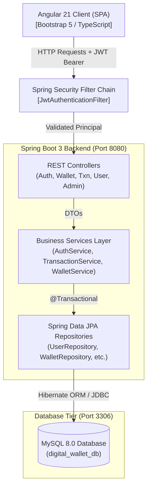
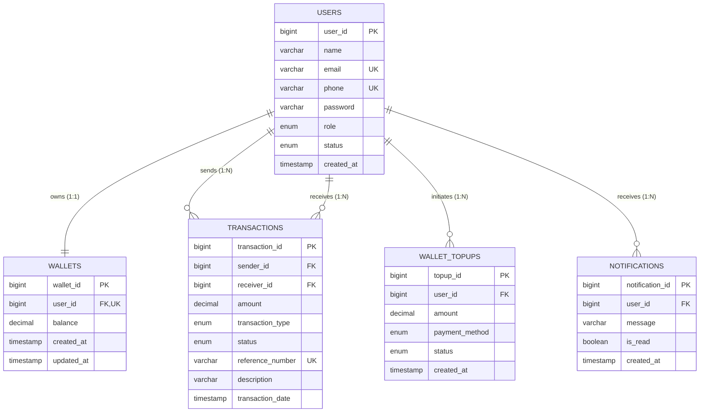
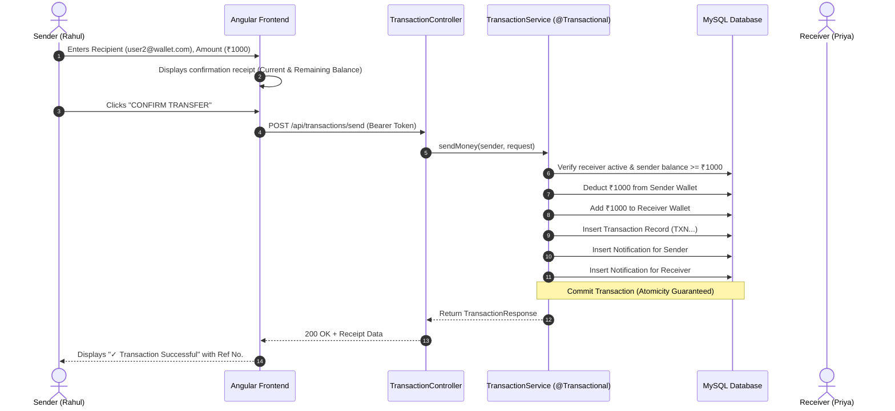

# Digital Wallet and Transaction Management System (PayPulse)
## BTech CSE Final Year Major Project Report & Viva Technical Guide

---

### 1. Abstract
The **Digital Wallet and Transaction Management System (PayPulse)** is a secure, scalable, and responsive full-stack financial technology web application designed to facilitate instantaneous peer-to-peer (P2P) electronic fund transfers, safe simulated payment gateway top-ups, transaction logging, real-time activity notifications, and administrative auditing. Built using **Java 17, Spring Boot 3, Spring Security, JWT (JSON Web Tokens), Spring Data JPA, Hibernate, MySQL**, and **Angular 21** with **Bootstrap 5**, the system eliminates single points of failure in monetary balances by enforcing ACID transactions (`@Transactional`), BCrypt password hashing, and role-based access control (RBAC).

---

### 2. Problem Statement
Traditional cash transactions and fragmented banking portals often suffer from cumbersome authentication flows, lack of centralized spending visibility, latency in settlement, and risks of financial inconsistency due to non-atomic balance updates. In academic and enterprise environments, there is a distinct requirement for a lightweight, self-contained digital wallet that simulates electronic clearing without interfacing with real monetary liabilities, while rigorously maintaining enterprise-grade security standards and relational integrity.

---

### 3. Objectives
1. **Zero-Balance Discrepancy**: Guarantee atomic money transfers where sender deduction and receiver addition occur within a single database transaction rollback boundary.
2. **Robust Security**: Enforce end-to-end tokenized authentication via stateless JWT and BCrypt password encryption (strength 10).
3. **Simulated Payment Gateway**: Provide realistic wallet top-ups through simulated UPI, Credit/Debit Card, and Net Banking channels.
4. **Complete Auditability**: Track every balance change with immutable, uniquely generated reference numbers (`TXN...`).
5. **Role-Based Separation**: Isolate regular end-user wallet operations from administrative telemetry, system-wide transaction auditing, and user freeze/unfreeze controls.
6. **Responsive UX**: Deliver a fintech-grade user interface with clear confirmation stages, debounced recipient search, and live balance counters.

---

### 4. Existing System vs. Proposed System

| Feature / Dimension | Existing System | Proposed PayPulse System |
| :--- | :--- | :--- |
| **Transaction Processing** | Manual ledgers or non-atomic REST endpoints | Spring `@Transactional` with automatic rollback |
| **Authentication** | Session-based / cookies or cleartext credentials | Stateless JWT tokens with BCrypt salted hashing |
| **Concurrency & Integrity** | Susceptible to race conditions & negative balances | Database check constraints (`balance >= 0`) & JPA locks |
| **Recipient Search** | Blind identifier entry causing erroneous transfers | Live search with masked privacy protection |
| **Administrative Auditing** | Direct database inspection | Dedicated Admin Analytics Dashboard with live charts |
| **User Notifications** | Missing or separate email delays | Real-time in-app notification ledger |

---

### 5. Requirements Specification

#### 5.1 Functional Requirements
- **FR1 User Management**: Registration with duplicate detection (Email, Phone), BCrypt encryption, login with JWT issuance, profile viewing, and password change.
- **FR2 Automated Wallet Provisioning**: Auto-creation of a wallet linked 1:1 with user account upon registration with an initial balance of ₹0.00.
- **FR3 Wallet Top-up**: Safe simulated payment gateway processing (UPI, Card, Net Banking) updating balances and creating top-up audit logs.
- **FR4 P2P Money Transfer**: Transfer funds by recipient email or phone; validates positive amount, sender balance sufficiency, active status of both parties, non-self transfer, atomicity, and generates receipts.
- **FR5 Transaction History**: Multi-parameter filtering (type, status, date, amount range), pagination, and individual receipt views.
- **FR6 In-App Notifications**: Automated notification generation on login, top-up, money sent, money received, and account status updates.
- **FR7 Administrative Console**: System dashboard metrics (total users, active/blocked count, total wallet balance, total turnover), user freezing/unfreezing, and full transaction ledger auditing.

#### 5.2 Non-Functional Requirements
- **Security**: Stateless authentication, CORS protection, SQL injection prevention via JPA parameterization, and XSS sanitization.
- **Performance**: Sub-100ms API response latency for cached lookups; indexed database columns for reference numbers and user lookups.
- **Reliability & ACID Compliance**: Atomic transactions ensure money cannot disappear or duplicate during system crashes.
- **Usability**: Responsive design accessible on desktop, tablet, and mobile devices following modern fintech UI guidelines.

#### 5.3 Hardware & Software Requirements
- **Operating System**: Windows 10/11, Linux (Ubuntu/Debian), or macOS.
- **JDK**: Java Development Kit 17 LTS.
- **Build Tool**: Apache Maven 3.9+.
- **Database**: MySQL Server 8.0+ / MySQL Workbench.
- **Frontend Environment**: Node.js 20+ / 24+, npm 10+, Angular CLI 21+.
- **API Testing**: Postman / cURL.

---

### 6. System Architecture

---

### 7. Entity Relationship (ER) Diagram Description

---

### 8. Data Flow Diagram (DFD Level 1 - Money Transfer)

---

### 9. Module Breakdown & Viva Defense Q&A

#### Q1: How do you prevent two transfers from resulting in a negative balance concurrently?
**Answer**:
1. In Java: Spring's `@Transactional` boundary combined with validation `senderWallet.getBalance().compareTo(amount) >= 0`.
2. In Database: MySQL table check constraint `CONSTRAINT chk_wallet_balance_positive CHECK (balance >= 0.00)`. Any attempt to write a negative value triggers an immediate SQL constraint violation and aborts the entire transaction.

#### Q2: How is authentication handled statelessly?
**Answer**:
We use standard RFC 7519 JSON Web Tokens (JWT) signed with HMAC-SHA256 (`Keys.hmacShaKeyFor`). The client stores the token in `localStorage` and the `authInterceptor` passes it via the `Authorization: Bearer <token>` header. The server verifies signatures on each request without requiring database session lookup.

#### Q3: Why use `BigDecimal` instead of `double` or `float`?
**Answer**:
Binary floating point types (`double`/`float`) cannot accurately represent decimal fractions like 0.1, causing IEEE 754 precision drift (e.g. `0.1 + 0.2 = 0.30000000000000004`). In banking and digital wallets, exact rounding using `BigDecimal` with scale 2 is mandatory.

---

### 10. Future Enhancements
1. **Two-Factor Authentication (2FA)** via TOTP or SMS OTP.
2. **Scheduled / Recurring Payments** using Spring Quartz or Cron scheduler.
3. **QR Code Scanning** using mobile device camera in Angular.
4. **Export to PDF / CSV** for tax invoices and annual account statements.
